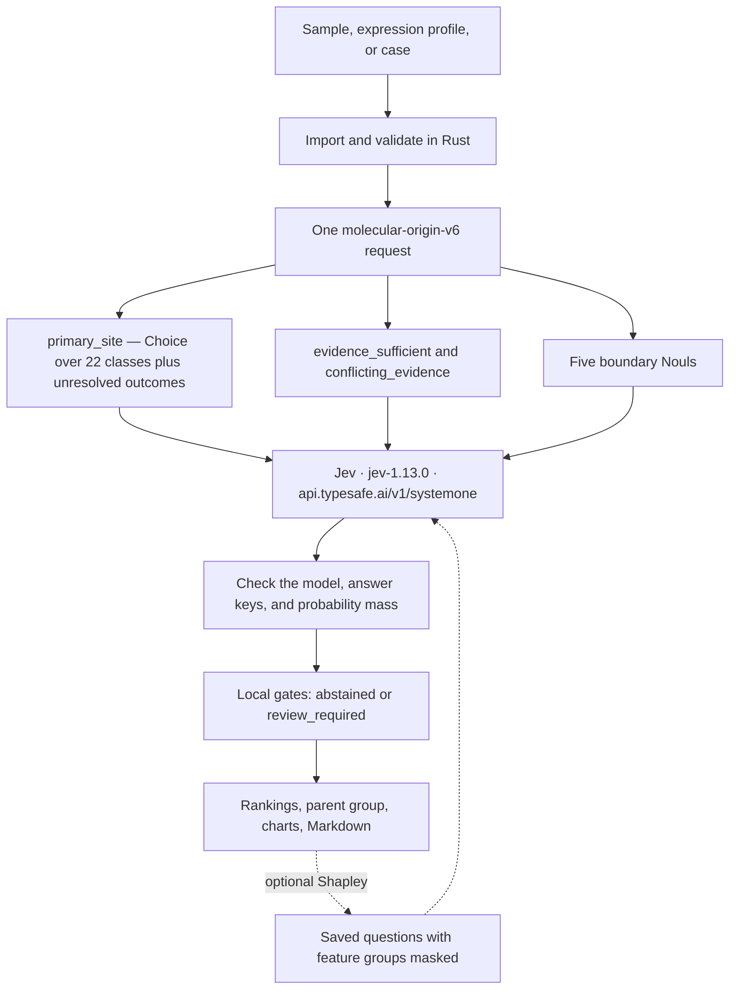

# Jev Onco Statistical Hierarchy (JOSH)

Rust workbench (Ratatui TUI and CLI) for cancer-of-unknown-primary research, version **0.8.0**. It loads molecular, expression, and clinical evidence, asks the hosted model **Jev** (`jev-1.13.0`) for an origin distribution, then checks, gates, charts, and exports the answer locally.

## How Jev is used



New prepares use `molecular-origin-v6`. The Choice, the two gated checks, and five boundary checks share the evidence and cannot read each other's answers. Boundary answers are reported with the result. Gates still use the leading score, its margin, sufficiency, and conflict. The parent of the leading class is a local lookup on the taxonomy. A request may use Jev's window: 64k tokens for the call, and 32k for the evidence plus the longest question.

New explanations reuse the saved full-evidence score. Each masked evaluation asks the same questions as the saved inference. Version 1 explanation archives keep their historical behavior. For v6, those archives used a separate three-question evaluation for the full score.

Live inference accepts declared **synthetic** data and requires `TYPESAFE_API_KEY`. Ordinary inference retries rate-limit and overload responses at most twice. `josh molecular prepare`, `josh reference compare`, and `josh reference prepare` run offline. `josh reference run` sends one synthetic expression-similarity request.

### Compare prompt versions

```bash
josh molecular compare-prompts manifest.json --out-dir comparison
```

This prepares a paired v5/v6 comparison offline. Pass `--baseline molecular-origin-v3 --candidate molecular-origin-v5` to reproduce the earlier pair. Live comparisons require `--execute` and submit each scheduled evaluation at most once. The report counts correct rankings, abstentions, and failures separately for named origins, `other_origin`, and `insufficient_evidence`. Reference labels stay local. [Comparison guide](docs/evaluation/PROMPT_COMPARISON.md)

## Workspace

| Crate | Role |
| --- | --- |
| `josh-core` | Contracts, prompts, response checks, gates |
| `josh-jev` | HTTPS client |
| `josh-ingest` | File and table import |
| `josh-features` | Mapping, signatures, reference comparison, cohort stats |
| `josh-explain` | Shapley values over a saved run |
| `josh-app` | CLI, TUI, loopback API |

## Start

```bash
./scripts/start
```

Requires Cargo, pinned Rust **1.98.1**, and a C compiler. In the TUI: open a bundled sample, then **Data → Run analysis**. `josh molecular prepare` prints the request without sending it. `josh --help` lists commands.

[Quickstart](docs/QUICKSTART.md) · [User guide](docs/USER_GUIDE.md) · [Jev workflow](docs/references/JEV_WORKFLOW.md)

## License

The study question takes its inspiration from OncoNPC:

Moon et al., *Machine learning for genetics-based classification and treatment response prediction in cancer of unknown primary*, Nature Medicine 29, 2057–2067 (2023). [doi:10.1038/s41591-023-02482-6](https://doi.org/10.1038/s41591-023-02482-6)

Authors' repository: [itmoon7/onconpc](https://github.com/itmoon7/onconpc)

JOSH is a separate Rust program. It contains no OncoNPC source, weights, or data. Origin inference is Jev. OncoNPC's classifier is XGBoost, and that model is not in this repository.

Licensed under the [MIT License](LICENSE).
